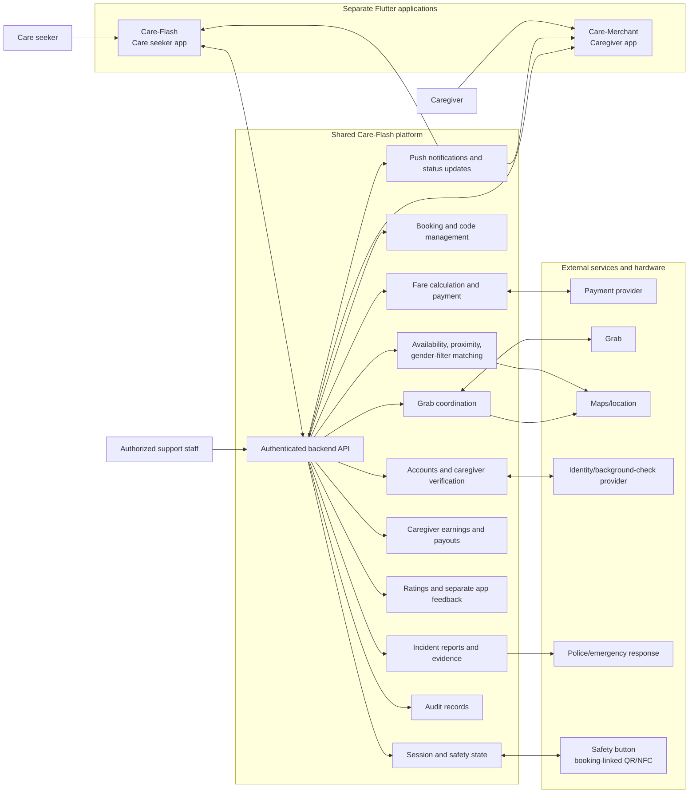

# Care-Flash Shared Platform Diagrams

The platform is shared by the two separately maintained apps, [Care-Flash](./Care-Flash_Mermaid.md) and [Care-Merchant](./Care-Merchant_Mermaid.md).

## 1. Shared platform architecture



## 2. Shared request-to-session lifecycle

```mermaid
sequenceDiagram
    actor Seeker as Care seeker
    participant CS as Care-Flash
    participant Platform as Shared platform
    participant CM as Care-Merchant
    participant Grab
    participant Button as QR/NFC safety button
    participant Emergency as Support/emergency response

    Seeker->>CS: Enter help type, optional description, checklist, location, time/duration, gender filter
    CS->>Platform: Submit request and request criteria
    Platform->>Platform: Match nearby available verified caregiver by gender
    Platform-->>CS: Return match/no-match and preliminary estimate
    Platform->>Platform: Calculate caregiver price + 5% app fee + estimated Grab fare
    Platform-->>CS: Return caregiver profile and itemized price
    Seeker->>CS: Select payment method and pay
    CS->>Platform: Authorize payment
    Platform->>Platform: Generate private client verification code
    Platform-->>CS: Return paid-pending status and private client code
    Platform-->>CM: Send request reference, help type, description, checklist, expected caregiver pay
    Note over CM,Platform: Hide care seeker location and private client code until caregiver accepts
    CM->>Platform: Accept request
    Platform->>Platform: Confirm booking
    Platform-->>CS: Notify care seeker that caregiver accepted
    Platform->>CM: Reveal accepted booking destination and Grab pickup status
    Platform->>Grab: Arrange caregiver pickup and ride
    Grab-->>CM: Pickup and ride status
    CM->>Seeker: Meet care seeker and check presented client code
    CM->>Platform: Submit client code for booking verification
    Platform-->>CM: Confirm code valid
    CM->>Button: Generate/activate booking-linked QR or NFC
    CM->>Seeker: Hand over physical safety button
    Seeker->>CS: Scan QR or read NFC
    CS->>Platform: Verify button identifier for booking
    Platform-->>CS: Confirm session may start
    Platform-->>CM: Confirm session start and provide checklist/timer
    alt Normal completion
        CM->>Platform: Mark work complete
        Platform->>Platform: Close session; settle caregiver service earnings
        Platform-->>CS: Completion and feedback prompt
        Platform-->>CM: Earnings and feedback status
    else Care seeker ends early
        CS->>Platform: End Early action
        Platform->>Platform: End session and apply configured 50% compensation
        Platform-->>CS: Session ended status
        Platform-->>CM: Compensation and earnings status
    else Care seeker reports / presses physical button
        CS->>Platform: Submit incident report
        Platform->>Platform: End session and initiate full care seeker refund
        Platform->>Emergency: Send incident report
        Platform-->>CS: Report/refund status
        Platform-->>CM: Session ended status
    else Caregiver SOS/report
        CM->>Platform: Submit SOS/report with booking
        Platform->>Platform: End session and apply caregiver compensation policy
        Platform->>Emergency: Send incident report
        Platform-->>CS: Session ended status
        Platform-->>CM: Report and compensation status
    end
    opt Post-session feedback or incident evidence
        Seeker->>CS: Rate caregiver, give caregiver feedback, app feedback, or submit evidence
        CS->>Platform: Submit feedback/report
        CM->>Platform: Caregiver may rate/report care seeker with evidence
        Platform-->>CM: Show caregiver feedback in Care-Merchant
    end
```

## Shared decisions to confirm

- Caregiver response timeout and whether requests are offered sequentially or to several caregivers.
- Default gender filter and matching distance/radius.
- Grab fare changes, trip cancellation, and refund treatment.
- Basis and timing for the 50% early-end compensation and caregiver SOS compensation.
- Emergency-response integration, support process, evidence retention, and handling after failed verification.
