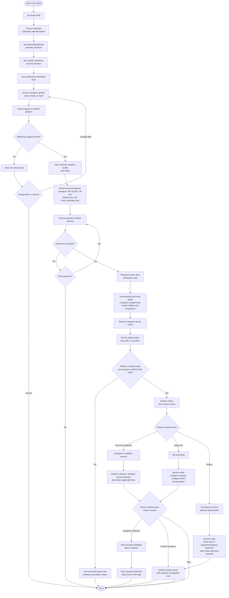

# Care-Flash App Flow

Care seeker app flow. Shared matching, pricing, payment, booking, and session rules are defined in [Care-Flash-Platform_SRS_IEEE830.md](./Care-Flash-Platform_SRS_IEEE830.md).

