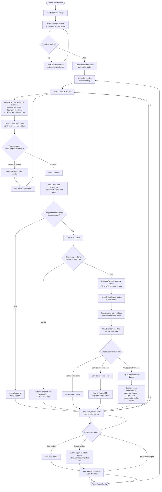

# Care-Merchant App Flow

Caregiver app flow. Shared matching, payment, booking, verification, and session rules are defined in [Care-Flash-Platform_SRS_IEEE830.md](./Care-Flash-Platform_SRS_IEEE830.md).

