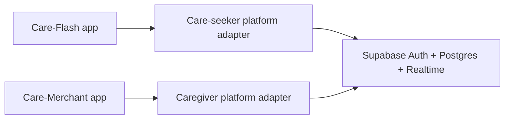

# Care-Flash

Care-Flash is a two-sided care service platform with two separate Flutter apps that share one backend:

- **Care-Flash** - care seeker application.
- **Care-Merchant** - caregiver application.

## Running the prototype

There are two ways to run the prototype:

- **Offline (mock platform).** Self-contained. There is no real backend, payment, Grab or emergency
  service: everything external is simulated inside `packages/care_core` so it can be swapped for a
  real API later. In this mode the two apps do **not** talk to each other: they are separate
  processes with no shared memory, so each one *simulates* the other side. Run them as two
  independent walkthroughs, not as one shared booking.
- **Connected (Supabase live demo).** The two apps share one Supabase project and genuinely talk to each other: a
  booking created in Care-Flash appears live in Care-Merchant and the caregiver's actions flow back.
  This is the mode to show that the two sides are really connected.

Every screen with a **bug icon** (debug builds only) opens **Demo Controls**, which fires the
simulated events for the other side. In connected mode the other side is a real app, so those
controls become no-ops.

### Offline (two independent walkthroughs)

```bash
# Terminal 1 - care seeker app
cd apps/care_flash
flutter run -d edge --dart-define=BACKEND_URL=mock  # or -d chrome

# Terminal 2 - caregiver app
cd apps/care_merchant
flutter run -d edge --dart-define=BACKEND_URL=mock
```

Signing in: any valid-looking email plus a password of 6+ characters logs you straight into a
ready, verified demo account. Use **Create account** instead if you want to walk through the
caregiver onboarding (residential ID, safety module).

### Connected live demo (Supabase + two Chrome windows)

Both apps use their own Supabase platform adapter. Supabase Auth owns accounts, Postgres stores
caregiver profiles and requests, row-level security controls access, and Supabase Realtime sends
request changes to the other app. Both apps must use the same Supabase URL and publishable key.



The project URL and its public publishable key are configured in both apps. On the web each app is
shown inside a phone frame.

```powershell
cd apps/care_flash
flutter run -d chrome

# In a second terminal:
cd apps/care_merchant
flutter run -d chrome
```

For another Supabase project, override `SUPABASE_URL` and `SUPABASE_PUBLISHABLE_KEY` in both app
commands with `--dart-define`. Use only the public publishable key, never a secret/service-role
key. For Android builds against the configured project:

```powershell
cd apps/care_flash
flutter build apk --release

cd apps/care_merchant
flutter build apk --release
```

Installed phones can connect from different networks; no local computer address is needed. Set the
Supabase Auth site's URL configuration to include the app's redirect URL when email confirmation
is enabled. Create one seeker and one caregiver account.

### Supabase signup email limits

Both apps use the same Supabase Auth project, so signup and verification emails share its project
email quota. Supabase Auth enforces this limit; resetting either app does not reset it, and there is
no app-side rate-limit feature to remove. The built-in email sender is limited to 2 emails per hour.
To raise the email quota, configure a custom SMTP provider or an Auth Send Email hook. In the
Supabase Dashboard, check **Authentication → Rate Limits** and **Authentication → SMTP Settings**.
Disabling **Confirm Email** in the Email provider stops signup confirmation emails and permits
immediate sign-in, but Supabase then does not verify the email address. The apps now explain this
limit when signup is rejected.

### Supabase database foundation

The app uses `profiles`, `caregiver_profiles`, `bookings`, protected booking details/secrets, and
rating/feedback tables. Request creation and lifecycle changes go through database RPC functions;
booking updates are broadcast over Realtime. Apply new migrations from `supabase/migrations/` to the
connected project before expecting newly added RPC features to work. For the newest safety-button
token lookup and laptop scan simulation, execute
`20261024153000_safety_button_demo_and_token.sql` in the Supabase SQL Editor. The linked project has
remote migration-history entries with no matching local files, so `supabase db push` currently stops
before applying migrations; reconcile those histories before using `db push` again. Never put a
Supabase secret/service-role key in an app build.

Caregiver matching only offers accounts whose identity status is approved and safety module is
complete. The prototype does not upload or store residential ID numbers or identity-card photos;
do not enter real identity details. Approve a test caregiver from the Supabase SQL editor after
creating the account:

```sql
update public.caregiver_profiles cp
set verification_status = 'approved', safety_module_completed = true
from public.profiles p
where cp.user_id = p.id and p.role = 'caregiver'
  and p.full_name = 'YOUR TEST CAREGIVER NAME';
```

The refreshed account screens support editing a display name and profile photo, plus saved language
and light/dark appearance preferences. Small profile photos are stored as data URLs on the user's
own `profiles` row. Matching shares the assigned caregiver's photo in that booking only. Feedback
and ratings are stored in `care_ratings`; RLS limits access to the rating's participants, and
caregiver ratings update the public rating summary. Withdrawals and actual money movement remain
demo-only.

At arrival, Care-Merchant shows the one-time caregiver verification code. The caregiver tells the
code to the care seeker, who enters it in Care-Flash. Supabase keeps the code private from the seeker
and allows the caregiver to read it only after arrival; the seeker's submission is checked by a
database RPC.

The payment step is a demo confirmation, not a real payment integration. Grab ordering is still
separate and is not connected to Grab's private backend.

### Deploy both apps online

`render.yaml` builds both Flutter web apps against the same Supabase project. Connect the repository
to Render as a Blueprint and deploy both static sites. The previous custom backend service may
remain in your Render account, but these app builds use Supabase directly.

The caregiver receives a live in-app request alert after the care seeker completes payment in
Care-Flash. The request also appears on the Care-Merchant Requests tab. This demo alert requires
Care-Merchant to be open and connected; push notifications while the app is closed need a push
service such as Firebase Cloud Messaging.

#### Install connected Android apps

Build both APKs with the configured Supabase project. Add `--dart-define` overrides to both builds
if you use a different project.

```powershell
cd apps/care_flash
flutter build apk --release

cd ../care_merchant
flutter build apk --release
```

Install the newly built APKs on both phones. Both apps point to the same Supabase project.

**Connected script (one booking, two windows):**

1. Care-Merchant: **Create account** → complete the demo safety module. In Supabase SQL editor,
   approve the test caregiver as shown above. Care-Flash: **Create account**.
2. Care-Flash: request a visit (help type → checklist → location/time/duration → gender filter →
   price) and pay the caregiver service plus platform fee. The care seeker separately orders and
   pays for the caregiver's ride in Grab; ride ordering/status is not integrated in this prototype.
3. Care-Merchant: the request lands in the **Requests** tab → **Accept** → **Start trip** →
   **Mark arrived**.
4. Care-Merchant shows its one-time caregiver code after arrival. The caregiver says it and the
   care seeker enters it in Care-Flash to confirm identity. Then verify the **safety button** in
   Care-Flash to start the session in both windows.
5. Care-Merchant: **Mark work complete**. The final booking status appears in both apps. The
   earnings and payout screens are still prototype-only; this Supabase setup does not move money.


## Demo script

A click-by-click walkthrough for each app. Each is self-contained and uses auto-advance or Demo
Controls to simulate the other side.

### A. Care-Flash (care seeker) - request a visit, pay, run a session, rate

1. Launch. Splash → login. Sign in (any email + 6-char password).
2. Home → tap the request CTA. Pick a **help type** and add an optional description → Next.
3. **Boundary checklist**: allowed tasks, disallowed tasks, off-limit rooms → Next.
4. **Location, date and time, duration** → Next.
5. **Caregiver gender filter** (default Both) → Next.
6. **Price estimate** (caregiver price + 5% fee, plus a separate Grab estimate) → submit. Matching status appears.
7. The caregiver auto-accepts after a few seconds. On the **matched** screen you see the caregiver
   profile and the itemized price → Continue.
8. **Payment**: pick GoPay / DANA / OVO / Mastercard to pay the service and platform fee.
9. Order and pay for the caregiver's ride in Grab. Grab dispatch and ride status are not connected
   to this prototype.
10. **Booking status** screen: watch caregiver acceptance and arrival updates.
11. At arrival, ask the caregiver to say the one-time code and enter it to confirm their identity.
    Care-Flash scans the live QR code shown in Care-Merchant and verifies its booking token through
    Supabase. On installed NFC-capable phones, Care-Merchant can write the same token to a writable
    NDEF tag for Care-Flash to read. Browser runs support camera QR scanning; NFC requires the
    installed mobile apps and a writable NFC tag.
12. **Active session**: a timer and the work checklist. Two separate actions:
    - **End Early** - ends the session, pays the caregiver the 50% early-end compensation, and
      refunds you the unused part.
    - **Report** (red, also triggered by the physical button) - ends the session, notifies support
      and the emergency channel, and **refunds the full amount**.
13. After the session, **rate the caregiver** and leave a visit note, then rate the **Care-Flash app**
    separately. Submit.
14. Open the **Activity** tab: the booking is listed with its payment / refund status.

### B. Care-Merchant (caregiver) - accept a request, run a session, get paid, give feedback

1. Launch. Splash → login. Sign in (any email + 6-char password) to land on a verified demo
   caregiver. (Use **Create account** to walk through onboarding: residential ID → simulated approval →
   safety module → badge.)
2. **Requests** tab: an incoming request arrives after a few seconds (or tap Demo Controls →
   *Simulate incoming request*). You see the reference, help type, description, boundary checklist
   and expected pay - never the care seeker's location or verification code. **Accept** or **Decline**
   within the 60-second window (declining has no rating penalty).
3. After accepting, the **booking** screen shows pickup and destination. The care seeker arranges
   and pays for the ride in Grab.
4. **Start trip** → **Mark arrived**.
5. Share your one-time caregiver code at arrival. The care seeker enters it to confirm your
   identity; a wrong code cancels the booking and notifies support.
6. **Button handover**: the care seeker scans the live booking QR in Care-Flash, or the caregiver
   writes the token to an NDEF tag and the seeker reads it. The shared Supabase booking moves to
   active only after the backend accepts the token. Demo Controls can still simulate this step.
7. **Session**: timer + work checklist. You can **Mark work complete**, **Report the care seeker**
   (with evidence), or raise an **SOS** (ends the session and applies the compensation policy).
8. **Mark work complete** - your service earnings are released to your balance.
9. **Earnings** tab: available balance, pending, total earned, paid out, and the transaction
   history. **Request withdrawal** once you are above the minimum.
10. **Feedback** tab: a **Rate the care seeker** prompt for the visit, plus the feedback the care
    seeker left about you (it arrives a few seconds after a session ends).
11. **Profile** tab: your rating and availability setting.

## Software requirements

- [Care-Flash care seeker SRS](./docs/Care-Flash_SRS_IEEE830.md)
- [Care-Merchant caregiver SRS](./docs/Care-Merchant_SRS_IEEE830.md)
- [Shared platform SRS](./docs/Care-Flash-Platform_SRS_IEEE830.md)
- [File-by-file presentation script](./docs/Project_Presentation_Script.md)

## Mermaid diagrams

- [Care-Flash care seeker flow](./docs/Care-Flash_Mermaid.md)
- [Care-Merchant caregiver flow](./docs/Care-Merchant_Mermaid.md)
- [Shared platform architecture and lifecycle](./docs/Care-Flash-Platform_Mermaid.md)

## Development Roadmap

The roadmap below follows the requirements in the SRS documents. Phase order is proposed; delivery dates and final scope are TBD.

1. **Project foundation**
   - Set up the Flutter monorepo with Melos.
   - Create the Care-Flash and Care-Merchant app shells and shared package.
   - Agree on supported platforms, development standards, and shared API contracts.
2. **Accounts and caregiver onboarding**
   - Implement account creation and login for both apps.
   - Add caregiver residential-ID/background verification, safety training, gender profile, and availability.
3. **Care request and matching**
   - Build the Care-Flash request flow: help type, optional description, boundary checklist, location, schedule, and caregiver gender filter.
   - Implement nearby available-caregiver matching and caregiver request accept/decline in Care-Merchant.
   - Show caregiver profile and itemized price estimates.
4. **Booking, payment, and transport**
   - Integrate a payment provider and calculate caregiver service price, 5% platform fee, and estimated Grab fare.
   - Generate a private caregiver verification code after acceptance.
   - Let the care seeker arrange and pay for the ride in Grab. A direct Grab API integration is
     unavailable, so dispatch and ride status remain outside this prototype.
5. **Arrival verification and session safety**
   - Let the care seeker verify the caregiver's code in Care-Flash.
   - Generate or activate the booking-linked safety-button QR/NFC and verify it in Care-Flash.
   - Implement session start, boundary checklist, timer, End Early, Report, and caregiver SOS flows.
6. **Completion, incidents, and feedback**
   - Implement normal session completion, caregiver earnings, and payout history.
   - Add reports with evidence, support/emergency notifications, refund and compensation handling.
   - Add caregiver ratings/feedback, caregiver feedback visibility, and separate app feedback.
7. **Validation and release preparation**
   - Test both apps and shared platform flows together, including payment, ride, verification failures, cancellations, and emergencies.
   - Review privacy, security, accessibility, and performance requirements.
   - Resolve the open decisions recorded in the SRS documents before release.


## Planned Repository Structure

We will use a **Monorepo architecture** managed with **Melos** to share code (like models, API clients, or UI components) between both apps in the future.


## Setup & Prerequisites (For Developers)

To prepare your local environment for development, ensure you have the following installed:

1. **Flutter SDK**: Recommended version `^3.24.x` or latest stable.
2. **Melos**: Install globally via pub to manage the monorepo:
   ```bash
   dart pub global activate melos
   ```


### Initializing the Project

Once the workspace structures are generated, running the project will be as simple as:

```bash
# 1. Clone the repository
git clone https://github.com
cd Care-Flash

# 2. Bootstrap all apps and packages simultaneously (Runs pub get everywhere)
melos bootstrap
```
